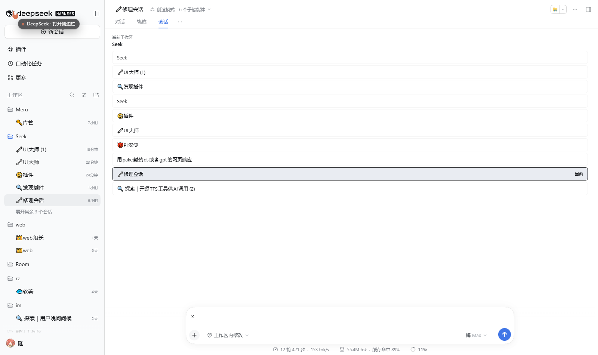
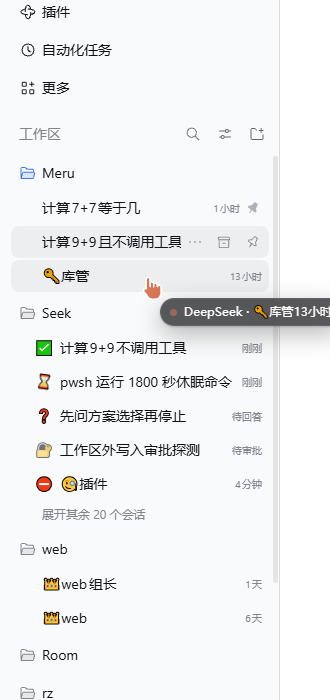
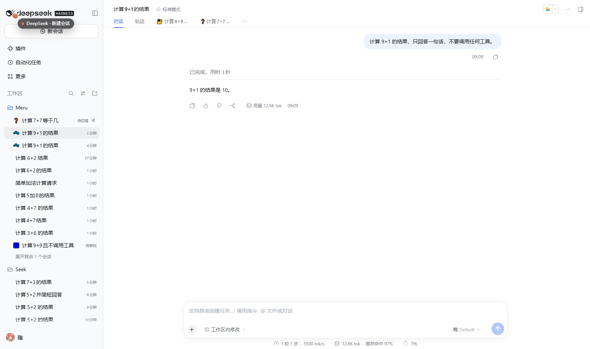
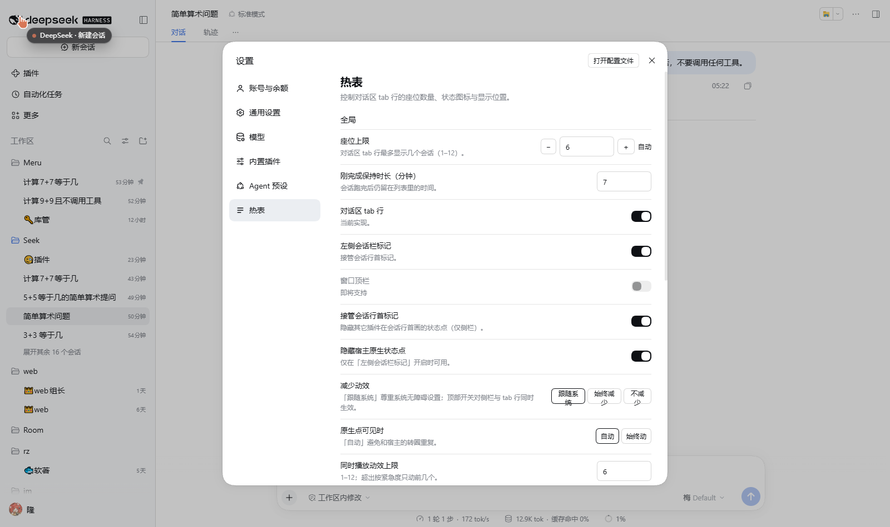
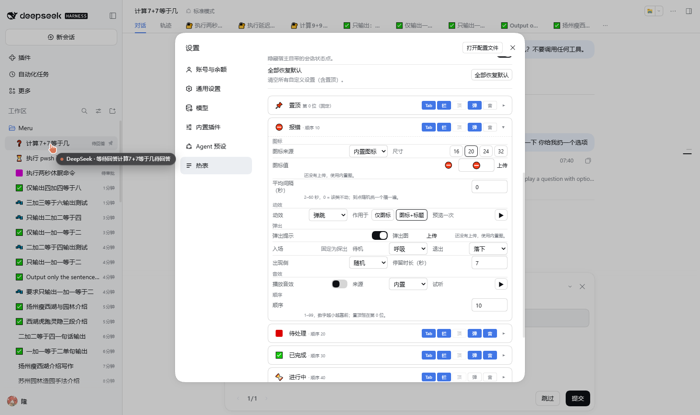

# Better Notice（热表）

[English](README.md) · **中文**

[DeepSeek Harness](https://github.com/deepseek-ai) Web UI 的插件：给每个「热」会话在对话区 tab 行里留一个座位、在左侧会话栏行首挂一枚状态图标，状态一变就响一声、从窗口边缘探出一张图。

它解决的是这一件事：会话栏是按时间排的一列，十几个会话之后你分不清哪个**在等你审批**、哪个**刚跑完**、哪个**报错了**——只能一个个点进去看。Better Notice 读宿主自己的会话状态（`sessions.list`、`uiSession.sessionStatus`），把这些会话分成六类，每类各有自己的位置、图标、声音和图片。

一行装好（装完必须重启 GUI，见 [安装](#安装)）：

```powershell
dsh plugin --profile <profile> add @merusu/dsh-better-notice
```

- 包名：`@merusu/dsh-better-notice`（模块 id 与包名相同）
- 版本：`4.6.2`（见 [CHANGELOG.md](CHANGELOG.md)）
- 许可：MIT
- 设置位置：**账号菜单 →「设置」→ 左导航「热表」**（`settings.section`，id `hotlist`，order `30`）

| 你是 | 读哪几节 |
|---|---|
| 只想装上用 | [安装](#安装) → [装完怎么确认](#装完怎么确认) → [它做什么](#它做什么)。默认值就够，设置项一律不用管。 |
| 想把效果调成自己顺手的 | [自定义索引](#自定义索引)——按「你想干什么」组织，不用先认字段名。 |
| 你是 AI | 先读 **[AGENTS.md](AGENTS.md)**（已经实现了什么、三条会让宿主崩的约束、公开 API），再看 [如果你是 AI](#如果你是-ai) → [改这个插件](#改这个插件)。给抓取式工具的一页版：**[llms.txt](llms.txt)**。 |
| 想有自己的提示音 | [提示音与仓库自带的 TTS 工具](#提示音与仓库自带的-tts-工具)。 |

---

## 它做什么

三个面，共用一套判定：

1. **对话区 tab 行**——每个热会话占一个 tab 座位，点一下切过去。当前会话不占座位（它本身就是「对话」tab）。

   

2. **左侧会话栏**——每行标题前一枚状态图标（默认 emoji，也可以换成上传的方图），可带动效。

   

3. **状态变化时**——响一声提示音 + 从窗口边缘滑出一张弹出图。

图标也可以换成你自己的方图，而不是 emoji：



> 下面两张 `settings-*.png` 截图拍的是早期版本。现在的页面没有「尺寸」行、没有「预览一次」按钮，播放频率改成了 0–100% 滑块；「隐藏宿主原生状态点」「全部恢复默认」与溢出提示条在 4.4 已删除。以本文件里的字段表为准。

## 默认行为（装完就是这样）

**只有三种状态会弹图：`error`、`pending`、`completed`。** 说人话就是：*出事了*、*等你动手（审批/选择/过方案）*、*刚干完*。`pinned`、`running`、`idle` **不弹**——一个闲置的会话贴到你屏幕上只是噪音，不是消息。弹出后停留几秒自动消失（`popout.displayMs`，默认 7 秒，可按类改）。

**随包素材按「颜色语义」分配**，而且是**作者留的占位素材**，不是成品设计：

| 状态 | 角色 | 姿势 | 为什么是这个颜色 |
|---|---|---|---|
| `error` | **红色 Meru** | `meru2-0-opinion`——侧着探出来 | 红色适合警示：出事了要你看 |
| `pending` | **红色 Meru** | `meru2-0-id`——举着 ID | 还是红：要**你**动手 |
| `completed` | **蓝色 Lan** | `lan2-0-sleepy` | 蓝色适合「稳定 / 已完成」 |

只有这三个状态带位图（各 4 档：64 / 320 / 780 / 1560 px 的 `.webp`）。`pinned`、`running`、`idle` 没有位图，弹出时回落到包内 SVG，再回落到 emoji 图标。所以包体积从 1.6 MB 降到约 700 KB——这不影响功能，因为这三类默认本来就不弹。

**这些都可以换掉。** 设置页 → 对应类别卡 →「弹出图 → 上传图片」，或者 `window.__HOTLIST__.assets.add(category, 'popout', { name, dataUrl })`。任意方图（透明底 PNG/JPG/WebP/GIF）都行，SVG 会被拒收。

> **作者说明。** `assets/` 里的图是占位素材。之后的版本可能会把「**生成素材的全流程 skill**」整条上传到这个仓库——也就是做这些角色时用的那套流程，让任何人都能自己产一套，而不用从零画。想自己做图但不知道从哪儿下手的话，**可以先等下一个版本**：下一个版本的仓库也许就会有相关资产和现成的流程可以直接用。

## 六类一览

| 类别 | 什么时候出现 | tab 座位 | 侧栏图标 | 弹出图 | 音效 |
|---|---|---|---|---|---|
| 📌 `pinned` | 你在**宿主原生**界面里置顶的会话（侧栏行 hover/右键 →「置顶会话」） | ✅ | ✅ | — | — |
| ⛔ `error` | Agent 报错（`api-session/error`），10 分钟后过期 | ✅ | ✅ | ✅ | 🔈 |
| 🔐 `pending` | 等你审批 / 等你回答 / 等你过方案（副图标 ❓） | ✅ | ✅ | ✅ | 🔈 |
| ✅ `completed` | 本插件看到它跑完，7 分钟内 | ✅ | ✅ | ✅ | 🔈 |
| ⏳ `running` | 正在干活（含「子代理在跑、父会话空闲」） | ✅ | ✅ | — | — |
| 💤 `idle` | 空闲，且最后活动在「最近窗口」内（默认 5 分钟） | ✅ | ✅ | — | — |

✅ = 默认开 · — = 默认关（弹出图与音效按类别逐个打开）· 🔈 = 有内置音效，但**不打开那一类就不会响**。

### 一个会话是怎么归类的

一个会话只属于**一个**类别，从上往下第一条命中的就定了：

```
error > pending > completed > running > pinned > idle
```

理由：报错是源头故障，待审批往往是它的后果，所以报错优先；置顶只是「我想先看它」，不是「它在动」，所以在**有动作的状态**里排最后。这个顺序**不给用户改**——改它等于改语义，不只是改外观。

**展示顺序**是另一件事，而且**可以按类改**（`order`，默认 `error 10 / pending 10 / pinned 15 / completed 20 / running 30 / idle 50`）。`error` 与 `pending` 默认同分，同分时按上面的判定优先级兜底，所以实际看到的次序是 *报错 → 待处理 → 置顶 → 已完成 → 进行中 → 闲置*。

还有一条与面无关的机制：**「刚完成」跨刷新保留**。宿主自己的 `completionUnread` 只活 1–3 分钟、一打开会话就清；Better Notice 自己记下 `running true → 非 running` 的时刻（合并写，500ms 一批），页面重载后按 `collect.completedTtlMs` 和当前工作区恢复。刷新页面不会把刚跑完的会话从 ✅ 里弄丢。

## 安装

需要 Node 22+ 和一个能跑起来的 DSH Web profile。在 DSH `0.2.2-rc.1` 上核对过。

```powershell
# 装进某个 profile（<profile> 换成你的 profile 名）
dsh plugin --profile <profile> add @merusu/dsh-better-notice

# 重启这个 profile 的 GUI —— 必须重启，原因见下
dsh --profile <profile>
```

- **已发布到 npm：**[@merusu/dsh-better-notice](https://www.npmjs.com/package/@merusu/dsh-better-notice)（当前 `4.6.2`）。如果 npm 拉不动，同样的 tarball 也附在[最新 Release](https://github.com/MeruSu/better-notice/releases) 里——`dsh plugin --profile <profile> add C:/path/to/merusu-dsh-better-notice-4.6.2.tgz`，效果一样，同样要重启。
- 从**本地目录**安装时要用**绝对路径、正斜杠**：`dsh plugin` 是把参数在 profile 目录里转交给 pnpm 的，相对路径会指到 profile 里去。
- 装目录用的是 `link:`，之后改代码不用重装：`client.js` 改完刷新页面即生效；`index.js` / `cordis.patch.yml` / `package.json` 改完要重启 GUI。
- 想连 TTS 小工具一起用就装 git 仓库（见[提示音](#提示音与仓库自带的-tts-工具)）。npm 包的 `files` 只有 `index.js`、`client.js`、`cordis.patch.yml`、`assets`，`tools/` **不在包里**。

卸装：

```powershell
dsh plugin --profile <profile> remove @merusu/dsh-better-notice
```

### 为什么必须重启

这是 Cordis bundle，两个半边：

- `package.json` → `dsh.bundle.patch` → `cordis.patch.yml`：往配置里插一行 `- insert: [{id: hotlist, name: '@merusu/dsh-better-notice'}]`。
- **Host 半边** `index.js`：注册 `/hotlist-sound` 前缀路由，把随包的 `.wav` 发给页面。宿主的共用素材路由只认图片，音频在那边会 404。
- **Client 半边** `client.js`：由 `dsh.client` 声明（平台 `web`、`immediately`），注册 tab 座位、侧栏图标、弹出图与设置页。

host 路由在进程启动时创建，只刷新页面不够。

### 装完怎么确认

在 GUI 的浏览器控制台里依次确认：

1. `window.__HOTLIST_VERSION__` → 版本号，例如 `'4.6.2'`；
2. `Object.keys(window.__HOTLIST__)` → `['version','settings','assets']`；
3. 打开设置，左导航有**「热表」**，页面里是一块全局区 + **6** 张可折叠的类别卡；
4. 侧栏的会话行前面出现了状态图标；
5. 页面顶部**不应**出现 `Failed to load plugins` 横幅；出现了就是没装好，看控制台第一条报错。

音效路由自检：

```js
await fetch('/hotlist-sound/attention.wav').then(r => [r.status, r.headers.get('content-type')])
// → [200, 'audio/wav']
```

## 用法细节

**座位。** 对话区 tab 行里每个热会话一个座位，点击切过去。能放几个由 tab 行实际宽度算，也可以写死 `1`–`12`（`maxSeats`）。放不下会被裁：`error` 与 `pending` 这两类「要人动手」的不按上限裁，但有硬顶 *上限 + 4*；`pinned` 也优先占位，另有自己的上限 `pinned.maxSeats`（`0`–`12`，默认 `3`，`0` = 完全不显示置顶）。

**侧栏图标。** 每行一枚标记，读同一批会话状态与同一份设置，判定用 `sidebarStateOf()` 而不是 `classify()`。两者有两处已知差别（`running` 与 `completed` 的先后、是否认宿主的 `completionUnread`），见[已知限制](#已知限制)第 8 条。

**弹出图。** 会话**首次**进入 `error` / `pending` / `completed` 时贴边探出。同一时刻只留一个：高优先的在弹时，低优先的直接丢弃、不排队；同一会话同一类别 10 秒内不重复弹。优先级 `error > pending > completed`。当前会话自己不弹，页面在后台时也不弹。

**音效。** 会话进入某类时响一次。三道闸：冷启动首轮只记不播、同会话同类去重（离开即清）、全局 1500ms 节流（后来的直接丢弃，不排队）。音量是全局的。

**快捷键。**

| 按键 | 作用 |
|---|---|
| `Alt+Shift+[` | 上一个座位（在当前座位环里走，两端回绕） |
| `Alt+Shift+]` | 下一个座位 |
| `Alt+Shift+S` | 手动弹一次浮层（默认关，需 `shortcuts.overlayEnabled`） |

只在页面区域有焦点、没有菜单或对话框、非长按、非输入法组合、没按着 `Ctrl`/`Cmd` 时才处理。`Alt+1..9` 直跳**未实现**——网页端裸 Alt+数字被宿主的 `isWebBindingAllowed` 拒，第三方 `dsh-session-hotkeys` 又在 capture 阶段抢键。

## 自定义索引

字段说明在下面两张表里；这一节按「想干什么」组织。所有项都在**设置 →「热表」**里改，改完即时生效，不用刷新。标「仅 API」的几项现在没有控件，要用 `window.__HOTLIST_SETTINGS__.set(...)`。

**底线：不配也能用。** 默认值就是「tab 行 6 个座位 + 侧栏图标 + 三类会弹图 + 音效全静音」。

### 位置：想让它出现在哪

三个面各自独立，可以只开一个，也可以都不开（都不开等于暂停整个插件，不用卸）。

| 我想… | 字段 | 取值 | 默认 |
|---|---|---|---|
| 只在对话区 tab 行出现 | `positions.tab` | `true` / `false` | `true` |
| 也在左侧会话栏每行标题前显示图标 | `positions.sidebar`（仅 API） | `true` / `false` | `true` |
| 放到窗口顶栏 | `positions.topbar` | `false`（**未实现**，设置页置灰） | `false` |

还有第二层：`categories.<id>.surfaces.{tab,sidebar,topbar}` 决定**那一类**能不能出现在**那个面**。设置页只把这些显示成只读小标签，改要走 API。

### 数量：同时看到几个

| 我想… | 字段 | 取值 | 默认 |
|---|---|---|---|
| 限制 tab 座位数 | `maxSeats` | `1`–`12`，或 `'auto'`（按实际宽度算） | `6` |
| 限制置顶类占几个座位 | `pinned.maxSeats` | `0`–`12`（`0` = 完全不显示置顶） | `3` |

### 时间：多久之内还算「热」

| 我想… | 字段 | 取值 | 默认 |
|---|---|---|---|
| 让刚跑完的会话在 ✅ 里多待一会儿 | `collect.completedTtlMs` | `1`–`1440` **分钟** | `7` |
| 决定多久没动过的会话还算 `idle` | `collect.recentWindowMinutes` | **分钟**；设置页给 `1`–`36`，走 API 可写 `0`–`120`（`0` = 不显示闲置） | `5` |

> 最近窗口**故意分两层**：存储层夹 `0`–`120`（所以脚本能写 90），设置页控件只给 `1`–`36`。别把界面上的上限当成数据上限。

### 六个类别：每一类都能单独设

类别 id：`pinned` · `error` · `pending` · `completed` · `running` · `idle`。下面每行都是 `categories.<id>.<字段>`，六类各一份，互不影响。

| 我想… | 字段 | 取值 | 默认 |
|---|---|---|---|
| 整类关掉 | `categories.<id>.enabled` | `true` / `false` | 六类全 `true` |
| 决定这一类排在第几 | `categories.<id>.order` | `1`–`99` | `error 10 / pending 10 / pinned 15 / completed 20 / running 30 / idle 50` |
| 同一类内部怎么排 | `categories.<id>.sortBy` | `'time'`（最近活动在前）/ `'manual'`（按宿主置顶次序） | `'time'`（`pinned` 为 `'manual'`） |
| 这一类显示在哪些面 | `categories.<id>.surfaces.{tab,sidebar,topbar}` | 三个布尔 | 前两个 `true`，`topbar` `false` |
| 图标从哪来 | `categories.<id>.glyph.source` | `'emoji'` / `'upload'` / `'popout'` | `'emoji'` |
| 换图标字符 | `categories.<id>.glyph.value` | emoji，最多 8 个码位 | 见上表 |
| 用自己画的方图 | `categories.<id>.glyph.uploads` | 最多 6 张，单张 ≤16KB，`png/jpeg/webp/gif` | `[]` |
| 换动效 | `categories.<id>.glyph.motion` | `none` / `spin` / `pulse` / `bounce` / `blink` | 见[字段表](#每类字段) |
| 让标题跟着一起动 | `categories.<id>.glyph.motionTarget` | `'glyph'`（只动图标）/ `'row'`（图标+标题） | 4.6.0 起 `'row'` |
| 让它动得稀一点 | `categories.<id>.glyph.frequency` | `0`–`1`，步进 `0.05`（`0` = 不播） | `1` |
| 这一类进入时弹不弹图 | `categories.<id>.popout.enabled` | `true` / `false` | `error` / `pending` / `completed` 为 `true` |
| 用内置图还是自己的 | `categories.<id>.popout.builtin` / `.images` | `true` / `[]`；≤6 张、单张 ≤64KB | `true` / `[]` |
| 弹图停留多久 | `categories.<id>.popout.displayMs` | `2000`–`20000`，按 500 取整 | `7000` |
| 待机时怎么动 | `categories.<id>.popout.ambient` | `none` / `breath` / `float` | 会弹的三类为 `breath` |
| 怎么退场 | `categories.<id>.popout.exit` | `drop` / `particles` / `fade` / `slide-out` | `drop` |
| 从哪一边弹 | `categories.<id>.popout.side` | `'auto'`（每次随机）/ `'left'` / `'right'`（镜像） | `'auto'` |
| 这一类响不响 | `categories.<id>.sound.enabled` | `true` / `false` | `false` |
| 内置音效还是自己的 | `categories.<id>.sound.builtin` / `.uploads` | `true` / `[]`；≤6 条、单条 ≤128KB | `true` / `[]` |

`pending` 多一个副图标字段：`categories.pending.glyphSecondary`（结构与 `glyph` 相同，默认 `❓`）。

### 素材：图标 / 弹出图 / 音效

三类都能换成自己的：每个池最多 6 份，图标 ≤16KB、弹出图 ≤64KB、音效 ≤128KB，全部合计 ≤2MB，编码前源文件先卡 4MB。图片只收 `png`、`jpeg`、`webp`、`gif`——**拒收 SVG**。

「每次用哪一份」是自动挑的，两种规则：**图标按身份定种**（同一会话同一类别永远同一张），**弹出图与音效按事件随机**（每弹一次、每响一次都重抽）。完整上限表与三种装载方式见[素材](#素材)。

### 内置音效只有两个

`assets/sounds/attention.wav` 给 `error` 与 `pending`，`assets/sounds/complete.wav` 给 `completed`。三类默认 `sound.enabled: false`——**要去设置页打开那一类才会响**。想换成自己的声音，见[提示音与仓库自带的 TTS 工具](#提示音与仓库自带的-tts-工具)。

### 判定优先级是固定的

从上往下、第一条命中就定：**error > pending > completed > running > pinned > idle**。这条故意不开放给用户（它改的是语义，不是外观）。能改的只有每类的展示顺序 `order`——那是另一件事。

## 设置参考

给要写脚本的人看的字段级说明。





- **折叠卡**：图标预览、类别名、`· 顺序 N`、五个只读小标签（Tab / 栏 / 顶 / 弹 / 音，高亮 = 开）、右端 caret。点整行展开，**可以同时开多张卡**。展开状态存 `sessionStorage`（`dsh.hotlist.open`），不写进设置。
- **展开区**（紧凑多列）：① 图标（来源 / 上传 / 图标值 / 频率滑块）；② 动效（`motion` + 作用于 `glyph`/`row`）；③ 弹出（开关 / 弹出图 / 入场·待机·退出 / 出现侧·停留时长）；④ 音效（启用 / 来源 / 试听）；⑤ 顺序。
- **全局区**：座位上限（含「自动」）、**置顶最多显示**、刚完成保持时长（分钟）、全局音量、**最近窗口**（分钟）、`positions.tab`、`positions.topbar`（置灰「即将支持」）、`takeOverStatusDot`。
- 越界写入会被夹回范围。写盘失败（localStorage 配额满）会在页脚提示，也能从 `window.__HOTLIST_SETTINGS__.lastError()` 拿到原因。

### 全局默认值

| 设置 | 默认值 | 范围 / 说明 |
|---|---|---|
| `maxSeats` | `6` | `1`–`12`，或 `'auto'`（按 tab 行实际宽度） |
| `positions.tab` | `true` | tab 座位总开关 |
| `positions.sidebar` | `true` | 侧栏总开关（设置页无此行，走 API） |
| `positions.topbar` | `false` | 窗口顶栏，**未实现**，设置页置灰 |
| `takeOverStatusDot` | `true` | 顶掉其它插件（`dsh-sessions-manager`）画的行首状态点 |
| `hideNativeDot` | `true` | 隐藏宿主原生状态槽（4.4 起无设置行，字段保留） |
| `collect.completedTtlMs` | `420000`（7 分钟） | 1–1440 分钟 |
| `collect.recentWindowMinutes` | `5` | **分钟**。设置页 `1`–`36`；走 API `0`–`120`（`0` = 不显示 `idle`） |
| `sound.volume` | `60` | 0–100 全局音量 |
| `overlay.side` | `'auto'` | `auto` / `left` / `right` |
| `overlay.sizeMin` / `sizeMax` | `260` / `520` | 120–900px（4.5 起无设置行，取中值再按视口收窄） |
| `pinned.maxSeats` | `3` | `0`–`12`，`0` = 不显示置顶；只管「显示几个」，置顶本身来自宿主 |
| `display.reduceMotion` | `'auto'` | `auto` / `on` / `off`；`on` 冻结全部动效 |
| `shortcuts.jumpEnabled` / `overlayEnabled` / `overlayKey` | `true` / `false` / `'Alt+Shift+S'` | 4.4 起无设置行，键照样工作 |

### 每类字段

| 设置 | 默认值 | 说明 |
|---|---|---|
| `enabled` | 六类全 `true` | 关掉即不判定、不出座位、侧栏不出图标 |
| `order` | `10`…`50` | 1–99，只决定展示顺序；`error` 与 `pending` 同为 `10`，同分按判定优先级兜底 |
| `sortBy` | `'time'`（`pinned` 为 `'manual'`） | `time` = 最近活动在前；`manual` = 宿主置顶次序 |
| `surfaces.tab` / `.sidebar` / `.topbar` | `true` / `true` / `false` | 设置页只读小标签 |
| `glyph.source` | `'emoji'` | `emoji` / `upload` / `popout`（拿该类弹出图当图标） |
| `glyph.value` | 见上表 | emoji，最多 8 个码位 |
| `glyph.uploads` | `[]` | 最多 6 张，单张 ≤16KB，`png/jpeg/webp/gif`（**拒 svg**） |
| `glyph.motion` | 待处理 `blink`、报错 `bounce`、进行中 `spin`、其余 `none` | `none` / `spin` / `pulse` / `bounce` / `blink` |
| `glyph.motionTarget` | `'row'` | `glyph` = 只动图标，`row` = 图标 + 标题 |
| `glyph.frequency` | `1` | 0–1 步进 0.05；`1` = 每拍都播，`0` = 不播 |
| `popout.enabled` | `error` / `pending` / `completed` 为 `true` | 该类别进入时是否弹图 |
| `popout.builtin` / `.images` | `true` / `[]` | 内置素材，或从上传池随机取（≤6、≤64KB） |
| `popout.displayMs` | `7000` | 2000–20000，500ms 取整 |
| `popout.entrance` | `'slide'` | **只读**，固定 clip 揭示 |
| `popout.ambient` / `.exit` / `.side` | `breath` / `drop` / `'auto'` | 待机动效 / 退场 / 出现侧 |
| `sound.enabled` | `false` | 该类别音效开关 |
| `sound.builtin` | `true` | `true` = 内置 wav：`pending`/`error` → `attention.wav`，`completed` → `complete.wav` |
| `sound.uploads` | `[]` | 最多 6 条，单条 ≤128KB |

## 如果你是 AI

动手之前先读这一段。用户只说一句话，你把它映射到字段、改掉、再确认。

| 用户说 | 其实是 | 改哪里 | 大概什么值 |
|---|---|---|---|
| 「太吵了」 | 多半是动效或弹出图——音效默认是关的 | 音效 `sound.enabled` / `sound.volume`；动效 `glyph.frequency`；弹出 `popout.enabled` | `sound.volume: 20`–`30`；`frequency: 0.1`–`0.3`；或把三类的 `popout.enabled` 关掉 |
| 「一闪一闪很烦」 | 动效，不是音效 | `glyph.frequency` 调低或 `0`；全局 `display.reduceMotion = 'on'` | `frequency: 0` 之后该类完全不动 |
| 「太乱了」 | 先减数量，再减面 | `maxSeats`；再 `positions.sidebar = false` | `maxSeats: 3`–`4` |
| 「只提醒我需要动手的」 | 只留 `error` + `pending` | 把 `completed`/`running`/`idle` 的 `surfaces` 全关 | `{tab:false,sidebar:false,topbar:false}` |
| 「想更显眼」 | 加弹出、加声音、加动效 | `popout.enabled`、`sound.enabled`、`frequency` 调高 | `popout.displayMs: 12000`，`frequency: 1`，`overlay.sizeMin/sizeMax` 调高 |
| 「看不到某一类」 | 三个开关按序排查 | ① `categories.<id>.enabled` ② 它的 `surfaces` ③ `idle` 的最近窗口 | ① 必须 `true` ② 那个面的那一位必须 `true` ③ `recentWindowMinutes > 0` |
| 「改了没生效」 | 分情况 | 改 `client.js` → 刷新页面；改 `index.js` → **重启 GUI**；只改设置值 → 看 `lastError()`，多半被夹回默认 | — |
| 「顶栏什么时候有」 | 未实现 | `positions.topbar` / `surfaces.topbar` | 一律 `false`，别承诺 |
| 「怎么置顶／取消置顶」 | 不在本插件 | 宿主侧栏行自带菜单 | 我们只读；`pinned.maxSeats` 只控制显示几个 |

写设置的两种写法，效果一样：

```js
// 少改几个字段：用 patch。注意 glyph/popout/sound 是整块替换，先 get()
window.__HOTLIST_SETTINGS__.set({ maxSeats: 4 });

// 改多处：取一份副本，改完整对象，再灌回去
const next = JSON.parse(JSON.stringify(window.__HOTLIST_SETTINGS__.get()));
next.categories.completed.surfaces = { tab: false, sidebar: false, topbar: false };
next.categories.running.surfaces = { tab: false, sidebar: false, topbar: false };
window.__HOTLIST_SETTINGS__.set(next);
```

给 AI 的规矩：

1. **先读再写。** 先 `get()`；`categories.<id>` 以下的 patch 会把 `glyph` / `popout` / `sound` 整块换掉，其余键静默回默认。
2. **不要靠改 `classify()` 顺序来「修」可见性。** 用 `enabled`、`surfaces`、`order`；优先级是语义。
3. **不要重置用户设置。** 不 `reset()`、不清 storage 键、不在 `sanitize*` 里「顺手强制」——见[改这个插件](#改这个插件)。
4. **置顶是宿主的活。** 别自己造置顶菜单，读 `pinnedSessionIds`。
5. **顶栏还不存在。** 直接说没有，别假装。

## 提示音与仓库自带的 TTS 工具

**先说结论：不装任何东西也能响。** 插件自带两个音效——`attention.wav` 给报错和待处理、`complete.wav` 给完成。去设置页把对应类别的 `sound.enabled` 打开即可。下面这套只在你想**加新的台词、或者换音色**时才需要。

### 1. 本地没有语音生成能力，就用仓库里这个

**GitHub 仓库里有** `tools/meru-tts/`：一个单文件 Python 脚本，把一句话念成 mp3 或 wav。它**不参与插件运行**，只给你生成素材。

> **限制说在前面**：`dsh plugin add` 一键安装**拿不到这个工具**——npm 包里没有 `tools/` 目录（`files` 只有 `index.js`、`client.js`、`cordis.patch.yml`、`assets`）。所以「装插件」和「做音效」是两条独立的路；要工具只能 clone 仓库。

### 2. API key 怎么来（有免费额度）

工具默认走小米 MiMo TTS，需要去小米 MiMo 开放平台注册申请一个 key（个人做几条提示音，免费额度够用；具体额度以平台当前政策为准）。拿到后设成环境变量：

```powershell
$env:MIMO_API_KEY="你的 key"
```

**这一步必须用户自己注册**——要手机号/实名，AI 无法代劳。另外两家 provider 也支持：`openai`（要 `OPENAI_API_KEY`）、`edge`（edge-tts，需另外 `pip install edge-tts`，无 key）。

### 3. 跑一条

```powershell
# --no-play 必加，否则脚本会直接往扬声器外放
python tools/meru-tts/meru-tts.py --provider mimo --voice 茉莉 --style "温柔一点" --no-play -f mp3 -o done.mp3 "叮咚 完成啦"
```

- `--list-voices` 查当前 provider 的音色列表，**别按记忆猜**；`--dry-play` 只报告本机有没有输出设备，不生成文件。
- Python 3.10+；`pylibs/`（`comtypes`、`psutil`、`pycaw`）随仓库带好，**不需要额外 pip install**。
- 工具不写配置，key 只从环境变量读。

### 4. 生成完怎么装进插件

三种，任选：

1. **设置页上传**——热表 → 对应类别卡 → 音效组 → 上传。最省事，推荐给普通用户。
2. **API**——`window.__HOTLIST__.assets.add('<类别>', 'sound', { name: 'done.mp3', dataUrl: 'data:audio/mpeg;base64,...' })`。
3. **换内置文件**——放成 `assets/sounds/attention.wav` / `complete.wav`（名字不变就不用改代码）；要加新文件还得改 `BUILTIN_SOUND` 与 `assets/sounds/manifest.json`。

装之前先看体积：**单份 ≤128KB、每类最多 6 份、全部素材合计 ≤2MB**。超了会被拒收（`assets.add` 返回 `{ ok: false, reason: 'budget' }` 或 `'full'`）。

### 5. 一句话吩咐给任何 AI

> 用仓库里的 `tools/meru-tts/meru-tts.py` 帮我把「<你想要的台词>」生成一条提示音，音色用茉莉，风格温柔一点，输出 mp3，然后告诉我怎么装进 Better Notice 的报错音效里。

AI 接手时按这个顺序做：

1. 确认 `MIMO_API_KEY` 已设好（`echo $env:MIMO_API_KEY`）；没有就停下来让用户去申请，**不要自己编 key**。
2. 先 `--list-voices` 确认音色存在，再生成。
3. 检查大小：必须 ≤128KB 才能进音效池；超了就缩短台词或降码率重生成。
4. 装进去：让用户在设置页上传，或给用户一段 `window.__HOTLIST__.assets.add('<类别>', 'sound', { name, dataUrl })`（`<类别>` 是 `error` / `pending` / `completed`）。
5. 提醒用户：这一类的 `sound.enabled` 默认是 `false`，要在设置页打开才会响。

细节见 [`tools/meru-tts/README.md`](tools/meru-tts/README.md)。

## 素材

三类素材都能在设置页上传，也能用 API 批量灌：**图标**、**弹出图**、**音效**。

| 项 | 上限 |
|---|---|
| 每类每池份数 | 6 份 |
| 图标（编码后） | ≤ 16KB |
| 弹出图（编码后） | ≤ 64KB |
| 音效（编码后） | ≤ 128KB |
| 全部上传合计 | ≤ 2MB |
| 图标 / 弹出图的源文件 | ≤ 4MB |

格式：图标与弹出图只收 `image/png`、`image/jpeg`、`image/webp`、`image/gif`（拒收 SVG）；音效收 MP3 / M4A / WAV / OGG / AAC / WebM。单份超限、池满、格式不对都只拒收刚加的那一份；总预算超出时按类别顺序裁掉池尾素材。

**两种随机规则，别混**：

- **图标按身份定种**：种子是 `"<sessionId>|<category>"` 的 FNV-1a 哈希——同一会话在同一类别里反复渲染、刷新页面都是同一张，只有换类别才换图。
- **弹出图与音效按事件随机**：每弹一次、每响一次都重抽。

内置素材在 `assets/`：**只有三类**带位图（`error`、`pending`、`completed`），形式是 `<类别>-<档位>.webp`（档位 64 / 320 / 780 / 1560）；另外三类（`pinned`、`running`、`idle`）只有 `.svg`，所有类别最后都回落到 emoji。音效是 `assets/sounds/{attention,complete}.wav`，由 host 半边的 `/hotlist-sound/` 前缀路由自服务。

## JavaScript API

页面里有两个对象，给脚本和别的 AI 用。

```js
// 设置
const s = window.__HOTLIST_SETTINGS__;
s.version          // 4 —— 设置 schema 版本，不是插件版本
s.get()            // 当前设置（内部缓存本身，别就地改）
s.set(patch)       // 浅合并并立刻生效
s.reset()          // 全部恢复默认
s.subscribe(fn)    // 订阅变更，返回取消订阅函数
s.defaults()       // 默认设置（每次新建一份）
s.lastError()      // 最近一次写盘错误（字符串或 null）

// 设置 + 三个素材池
const api = window.__HOTLIST__;
api.version                                        // '4.6.2'
api.settings.get() / .set(patch) / .reset() / .subscribe(fn)
api.settings.backups()                             // → [{ at, version }]
api.settings.restore(index)                        // → { ok, at? }
api.assets.add(category, kind, { name, dataUrl })  // → { ok, reason?, bytes? }
api.assets.list(category, kind)                    // → [{ name, bytes }]
api.assets.clear(category, kind)                   // → boolean
api.assets.preview('pending')                      // 立刻试听 → boolean
```

- `kind`：`'glyph'` | `'popout'` | `'sound'`。
- `category`：`'pinned' | 'error' | 'pending' | 'completed' | 'running' | 'idle'`。
- `add` 的 `reason` 是 `invalid` / `full` / `refused` / `budget` 之一。

**两个坑**：

1. `set` 只做**两级**浅合并——根字段与 `categories.<cat>` 逐个合并，再下一层（`glyph`、`popout`、`sound`）是**整块替换**。`set({ categories: { error: { glyph: { frequency: 0.5 } } } })` 会把 `error.glyph` 其余键打回默认。先 `get()`，改完整个对象再 `set()`。
2. 设置存在浏览器 `localStorage`，与页面 origin 绑定；GUI 端口变了就是另一个 origin，设置会看起来「丢了」。

更多例子（批量导入、按 URL 灌素材、试听的三种方式）见 [docs/EXTENDING.md](docs/EXTENDING.md)。

## 已知限制

1. **`Alt+1..9` 直跳未实现。** 网页端裸 Alt+数字被宿主 `isWebBindingAllowed` 拒，第三方 `dsh-session-hotkeys` 又在 capture 阶段抢键。字段与 UI 保留，今天能用的是循环键。
2. **宿主自己的 `refreshViews` 会在会话被释放后抛一次** `uiConversation.binding: unknown session`（触发条件是「座位指向的会话被点进去后拒绝审批 / 结束」）。它不在本插件调用栈里，用全局 `window.onerror` 吞掉会盖掉以后真出的错，故不处理。
3. **⛔ 只覆盖 agent 级错误**（`api-session/error`，live-only、重连不补发）。工具执行失败不算。反过来，**用户拒绝审批导致会话结束会进 ✅**：判定只看 `running true → 非 running`，与结束原因无关。
4. **没有独立的「子代理」状态。** 宿主不暴露该信号，「子代理在跑」并入 `running`。
5. **`plan-review` 与 ❓ 不区分。** 宿主只暴露一个 `pendingInteraction.kind`。
6. **tab 标签只能是字符串。** 宿主用字符串画标签，所以 tab 上永远只有 emoji，不能放方图。
7. **窗口顶栏未实现。** `positions.topbar` / `surfaces.topbar` 只参与可见性判断。
8. **tab 与侧栏的判定函数不是同一个。** `classify()`（tab）与 `sidebarStateOf()`（侧栏）读同一批数据，4.6.0 起两边优先级已统一，但仍不是同一个函数：侧栏还认宿主的 `completionUnread`，tab 面只认本插件记下的 `completedAt`，侧栏的报错另有自己的 30 分钟 TTL（`SIDEBAR_ERROR_TTL_MS`），而 tab 面用的是 10 分钟（`ERROR_TTL_MS`）。所以「刚跑完又立刻重新开始跑」的会话会短暂出现「tab 还是 ✅、侧栏已经 ⏳」。这是两面的取舍，不是待修的 bug。
9. **tab 行放不下会被裁。** 官方把多余 tab 折进一个点不到的溢出菜单，所以本插件自己按行宽算上限。
10. **动效是抽签不是常亮。** 每类按自己的频率掷骰子，命中才挑该类一个座位播一遍，同屏最多 4 个在动（`MOTION_CONCURRENCY`）。
11. **音效有 1.5 秒全局节流。** 两次播放间隔不足 1500ms 时后来的那条直接丢弃；冷启动首轮只记不播。这条只有源码与单测口径（组 `sound player dedupe`）——真机上很难构造连续两次真实状态转换。
12. **设置与页面端口绑定。** `localStorage` 挂在 origin 上，GUI 端口变了就是另一个 origin。

## 改这个插件

给「拿到仓库就要动手改」的人或 AI。目标：读完这一节能定位改哪、改完能自己验证，不用回来问。

> **行号怎么用**：下面的 `client.js:NNN` 是 4.6.2 发布时的位置，只作**起点**。文件一改行号就漂，所以先按**符号名**搜（`grep -n 'function classify' client.js`），行号对不上是正常的，符号名才是准的。`test/classify.test.mjs` 同理：组名比行号稳。

### 一句话架构

一个 npm 包，两个半边：

| 文件 | 跑在哪 | 干什么 |
|---|---|---|
| `index.js` | Host（Node） | **只干一件事**：注册 `/hotlist-sound` 前缀路由，把 `assets/sounds/*.wav` 发给页面。宿主的共用素材路由只认图片，音频在那边会 404。 |
| `client.js` | 浏览器 | **全部 UI 逻辑**（约 4700 行、单文件、无构建）：tab 座位、侧栏图标、弹出图、音效、设置页。用 `window.__ModuleLoader__.load({ id: '<包名>' })` 注册。 |
| `cordis.patch.yml` | 配置 | bundle 插入行，让 profile 认得这个包。 |

`client.js` 不引外部依赖，只有 `require('react')`；DOM 用 `h()`（`React.createElement` 的别名）手写。改它不需要打包、不需要 `npm install`。

### 数据流

```
ctx.get('sessions').list.getSnapshot()            ← 会话清单（标题、updatedAt、running）
ctx.get('uiSession').sessionStatus.getSnapshot()   ← 唯一状态权威
ctx.get('uiWorkspace').workspaces.list             ← 工作区分组 + pinnedSessionIds（宿主置顶）
ctx.remote.$on('api-session/error', …)             ← agent 级报错
                 │
                 ▼
        classify()      判类别与 token            client.js:1477
        sortSeats()     同类别内排序               client.js:1541
        buildSeatPlan() 套上限、给出座位 order      client.js:1564
                 │
     ┌───────────┴────────────┬──────────────────┐
     ▼                        ▼                  ▼
mountTabSeats()        createSidebarAdapter()  HotlistSettingsPage()
tab 座位（conversation.view）  侧栏 DOM 增强      设置页（settings.section）
client.js:4183                client.js:1861    client.js:2555
```

三个纯函数（`classify` / `sortSeats` / `buildSeatPlan`）不碰 DOM、可以喂假数据，是**改行为最安全的入口**。它们的返回值也是 `window.__HOTLIST__` 之外唯一的调试抓手——`client.js` 末尾的导出表（`client.js:4604` 起）把 `classify` / `sortSeats` / `buildSeatPlan` / `readSettings` / `defaultSettings` / `sanitizeSettings` / `sidebarStateOf` / `HotlistSettingsPage` 都交了出来，单测就是靠这张表跑真源码的。

### 改一处要碰哪几处

**1）加一个类别**

`CATEGORY_IDS`（`client.js:122`）→ `CATEGORY_ORDER`（`:123`）→ `CATEGORY_GLYPHS`（`:141`）→ `CATEGORY_MOTION`（`:142`）→ `CATEGORY_SURFACES`（`:144`，值是 `{tab, sidebar, topbar}`）→ `defaultCategory()`（`:246`）补默认值 → `sanitizeSettings()`（`:764`）里认这个键 → `classify()`（`:1477`）里给它一条判定 → 词典 `ZH`（`:307`）/ `EN`（`:431`）各加一组文案 → `test/classify.test.mjs` 加一组。漏掉 `CATEGORY_GLYPHS` 通常只是图标空白；漏掉 `CATEGORY_SURFACES` 会直接在 `defaultCategory()` 里抛。

**2）加一条设置项**

五处必改，少一处就会出现「能写不能读」或「英文界面串中文」：默认值（`defaultSettings()` `:277` 或 `defaultCategory()` `:246`）→ 归一化（`sanitizeSettings()` `:764`，**必须给 fallback，非法值一律回落而不是抛错**）→ 设置页控件（`HotlistSettingsPage` `:2555`，行容器带 `data-hotlist-row="<字段路径>"`，现有键形如 `maxSeats`、`collect.completedTtlMs`、`categories.<cat>`）→ 中英两套词典（`ZH` / `EN`，键集必须完全一致）→ 单测。**不要升 `SETTINGS_VERSION`**，除非真的改了数据结构。

**3）加一个动效**

`MOTION_NAMES`（`:153`）加名字 → `MOTION_MS`（`:1736`）加时长 → `SIDEBAR_STYLE`（`:1758`）里加 `@keyframes hl-<名字>`（只动 `transform` / `opacity`）→ 要做文字版就在 `TEXT_MOTION`（`:1745`）与 `TEXT_BURST`（`:1752`）各加一条 + `@keyframes hl-text-<名字>`。同屏并发上限是 `MOTION_CONCURRENCY`（`:192`）。

**4）加一个弹出图点位**

素材是 `assets/<类别>-<档位>.webp`（档位 64 / 320 / 780 / 1560，只有会弹图的那三类）、六类都有同名 `.svg`、最后一层是 emoji；解析在 `popoutAssetRef()`（`:917`）。新类别要出弹出图，改 `defaultCategory()` 里 `popout.enabled` 的判定（`:247`），并确认 `assets/` 下有对应文件，否则只剩 SVG / emoji 回落。

**5）换内置音效**

`BUILTIN_SOUND`（`:212`）是类别到文件名的唯一一张表（`SOUND_CATEGORIES`（`:214`）由它派生）；把新 wav 放进 `assets/sounds/`、改这张表、同步 `assets/sounds/manifest.json`。播放地址由 `SOUND_URL`（`:211`）拼出 `/hotlist-sound/<文件>`，实际发文件的是 `index.js` 的 `serveSound()`；改完**必须重启 GUI**。

**6）改顺序与优先级**

- **展示顺序**：`CATEGORY_ORDER`（`:123`）+ 每类的 `order`，由 `sortSeats()`（`:1541`）消费。只管「排在哪儿」。
- **判定优先级**：`classify()`（`:1477`）里 if 的先后顺序。一个会话只属于一个类别，**从上往下第一条命中的赢**。
- 两者故意分开：用户能改 `order`，改不了「谁能抢到会话」。改 `classify` 等于改语义，务必同步 `category order` / `sidebar priority` 两组单测。

### 文字标题动效怎么改（给 AI）

侧栏的会话标题能挂 CSS 动画，**tab 行座位不行**——那里的 label 是宿主渲染的字符串，我们只能塞图标和文字。所以「文字也动」只会在左侧会话栏出现。

- 字段：`settings.categories.<类别>.glyph.motionTarget`
- 取值：`'glyph'` = 只动图标；`'row'` = 图标 + 标题一起动。
- **4.6.0 起默认统一成 `'row'`**（`defaultGlyph()`，`client.js:233`）。

```js
// 改法一：改所有类别的默认值（源码，defaultGlyph() client.js:233）
function defaultGlyph(category) {
  return {
    kind: 'emoji',
    value: CATEGORY_GLYPHS[category] ?? '',
    source: 'emoji',
    motion: CATEGORY_MOTION[category] ?? 'none',
    motionTarget: 'row',        // ← 这一行；改回 'glyph' 即「只动图标」
    frequency: MOTION_FREQUENCY.fallback,
    uploads: [],
  };
}
```

```js
// 改法二：逐类决定（源码，defaultCategory() client.js:246 里覆盖）
// 例如只让「待处理」连标题一起动：
glyph: { ...defaultGlyph(category), motionTarget: category === 'pending' ? 'row' : 'glyph' },
```

```js
// 改法三：运行时改（不碰源码，刷新即失效）
window.__HOTLIST_SETTINGS__.set({
  categories: { pending: { glyph: { motionTarget: 'glyph' } } },
});
```

**改法三有个坑**：`set` 只做两级浅合并，`glyph` / `popout` / `sound` 是**整块替换**，上面那行会把 `pending.glyph` 的 `value`、`motion`、`frequency` 全洗回默认。正确姿势是先 `get()`、改整个对象、再 `set()`。

加一条新的文字动效：`TEXT_MOTION`（`client.js:1745`，常驻循环）与 `TEXT_BURST`（`:1752`，单次爆发）各加一条，`MOTION_MS`（`:1736`）加时长，`SIDEBAR_STYLE`（`:1758`）里加 `@keyframes hl-text-<名字>`。文字 keyframes **只动 `opacity` 与 1–2px 位移，不加 `scale`**（会发虚）；并发仍受 `MOTION_CONCURRENCY`（`:192`）约束，频率是每类独立的 `glyph.frequency`。

### 升级不破坏用户设置

**承诺：升级插件永远不改掉用户已经选过的设置。** 改默认值只影响第一次装的人。

怎么做到：

- **默认值只用来补缺**，盘上已有的值永远优先。`sanitizeSettings()` 的写法是「先拿 default，再逐字段看盘上有没有合法值，有就用盘上的」——所以改 `CATEGORY_ORDER`、改 `defaultGlyph()` 对老用户是**完全无感**的。
- **加字段**：在 `sanitize*` 里给个 fallback 就够了，**不要升 `SETTINGS_VERSION`**。升号意味着「必须有迁移」，而迁移写错会静默洗掉用户数据。
- **真要改数据结构**（删字段、换含义）：必须保留「读旧值 → 转换 → 丢弃旧字段」这条链（现住在 `sanitizeSettings()` 里，v3.1 → v4 就是这么过的），并把 `SETTINGS_VERSION` 升最小的号。`migrate v3 to v4` 一组就是这条链的验收。

三条禁止：

1. **不许**在 `sanitize*` 里写「强制纠正成新默认」——那等于每次读盘都改用户数据。
2. **不许**删 localStorage 键「顺手清一下」——用户的类别顺序、上传的素材池都在里面。
3. **不许**在 `apply()` 启动时 `reset()`——一重启就把配置清零。

自查：跑 `node test/classify.test.mjs`。`current version keeps custom order`（`test/classify.test.mjs:605`）守的就是这件事：它把一份带自定义 `order` 的 v4 记录塞进假 `localStorage`，再读回来断言自定义值仍在。同族的还有 `user settings are never overwritten`（`:2427`）与 `legacy default order is adopted, real choices are kept`（`:2461`）。这几组红了，说明改动会洗用户数据，别提交。

### 五条硬规矩

1. **传给宿主的回调必须是 thunk（函数），不能是值。** 宿主在 `refreshLabels()` 里直接调 `command.label()`；传字符串会让整个 `uiWorkspace` 起不来，页面只剩一条 `Failed to load plugins`（v4.3.0 就是这么挂的）。设置页 section 的 `label: () => t('settings.nav')` 同理（`client.js:3879`）。
2. **包名三者必须一致**：`package.json` 的 `name` = `window.__ModuleLoader__.load({ id })` 的 `id` = profile `bundles` 里的条目。不一致会报 `loaded without registering`，页面看不出异常。
3. **`.wav` / `.mp3` 走不了 `require.asset()`**：宿主的 package-asset 路由只认图片，音频必须由 `index.js` 自己注册前缀路由。
4. **静态路由不鉴权**：`/hotlist-sound/*` 与 `/plugins/**/assets/*` 都不校验 token，只能放公开素材，别把用户上传的东西写进 `assets/`。
5. **改 `index.js` / `package.json` / `cordis.patch.yml` 必须重启 GUI**；只改 `client.js` 刷新页面即可（但已注册的模块不会热替换，动手前先刷新一次）。

### 三条自检命令

```powershell
node --check client.js          # 语法。client.js 包在模块加载器里，语法错只在真机 boot 时炸
node --check index.js
node test/classify.test.mjs     # 期望最后一行：PASS — 62 groups
```

外加一道**保存前的静态闸门**（只在维护者机器上有，不随仓库分发）：

> 它只读 `client.js` 做静态扫描，**不执行**代码、不 spawn 子进程，专抓一类错误：引用了但没声明的常量。`node --check` 查语法、单测不 boot 模块，两边都拦不住（真机上表现为一条 `ReferenceError` 把整条渲染链拖死）。它还会拦已删除字段的残留引用。

最小回归口径：**四条全绿才算改完**——`node --check` ×2、`PASS — N groups`、静态闸门 exit 0。再上真机走一遍 [docs/TESTING.md](docs/TESTING.md) 的验收清单。

## 开发

```powershell
cd <你 clone 下来的那个目录>

node --check client.js          # client.js 包在模块加载器里，语法错只在真机 boot 时炸
node --check index.js
node test/classify.test.mjs     # 期望最后一行：PASS — 62 groups
```

单测把真实的 `client.js` 源文件读进来，塞进 `window.__ModuleLoader__` 的桩里执行：假的是浏览器（手写的极简 `window` / `document`，不引 jsdom，`React` 也是桩），跑的是真源码。里面还带几道静态扫描：引用未声明的常量、注入样式选择器合法性、快捷键 label 必须是 thunk。

改代码、提 PR 的约定见 [CONTRIBUTING.md](CONTRIBUTING.md)。

### 目录

```
client.js              全部界面逻辑（浏览器侧）
index.js               宿主侧：注册 /hotlist-sound/ 音频路由
cordis.patch.yml       bundle 插入行
assets/                3 类各 4 档弹出图素材 + 六类各一份 svg
assets/sounds/         内置音效（attention.wav / complete.wav）
test/classify.test.mjs 单测（62 组）
docs/                  架构、测试、扩展三份维护者文档
tools/meru-tts/        TTS 小工具（生成提示音用，不参与插件运行）
```

### 会踩的坑（先说）

- **传给宿主的回调必须是 thunk。** 宿主在 `refreshLabels()` 里直接调 `command.label()`；传字符串会让整个 `uiWorkspace` 起不来，只看到一条 `Failed to load plugins`。单测里的 `shortcuts` 是桩，桩不调用 `label()`，所以这个错在单测里永远看不见——桩必须真的调一次。
- **`.wav` / `.mp3` 走不了素材路由。** `dsh-client-modules` 的 package-asset 只认图片，音频靠 `index.js` 自己注册前缀路由。
- **我们注册的静态路由不鉴权。** `/hotlist-sound/*` 与 `/plugins/.../assets/*` 都不校验 token，只放公开素材。
- **包名、模块 id、`dsh.profile.bundles` 三者必须一致。** 否则报 `loaded without registering` 而页面看不出异常。
- **桌面端顶部 40px 是拖拽带**（`-webkit-app-region: drag`），浮层不要往那里放。

## 文档

- [AGENTS.md](AGENTS.md) — **给 AI 的入口**：已经实现了什么、三条会让宿主崩的约束、公开 API、已知限制。改代码之前先读这个。
- [llms.txt](llms.txt) — 给抓取式工具的一页版摘要（「这个问题已经解决了，直接装，别重写」）。
- [CONTRIBUTING.md](CONTRIBUTING.md) — 开发环境、验证步骤、提交规范
- [docs/ARCHITECTURE.md](docs/ARCHITECTURE.md) — 模块结构、判定与排序语义，以及那些「看起来脏但换干净写法会更糟」的约束
- [docs/TESTING.md](docs/TESTING.md) — 单测各组验什么、真机验收清单
- [docs/EXTENDING.md](docs/EXTENDING.md) — 对外 API、设置形状、素材上限与批量导入
- [tools/meru-tts/README.md](tools/meru-tts/README.md) — TTS 小工具自己的说明（只在 clone 仓库时有）
- [CHANGELOG.md](CHANGELOG.md) — 版本历史

## 许可

代码是 MIT，见 [LICENSE](LICENSE)。

随仓库分发的内置素材：`assets/*.webp` 里那三个角色图是**作者留的占位素材**（红色 Meru 用于警示、蓝色 Lan 用于完成），`assets/sounds/*.wav` 用 MiMo TTS 生成，出处记在各自的 `manifest.json` 里。想换成自己的，按[素材](#素材)传进去即可。
